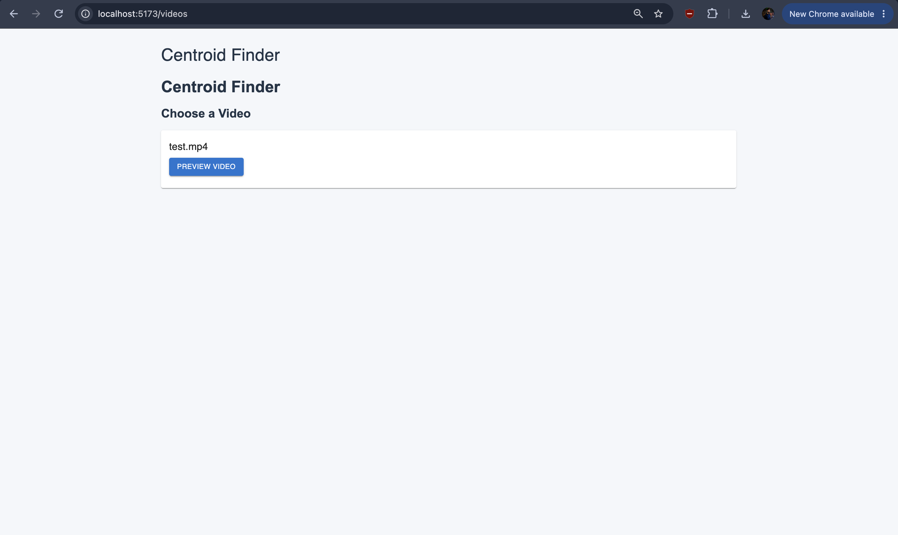
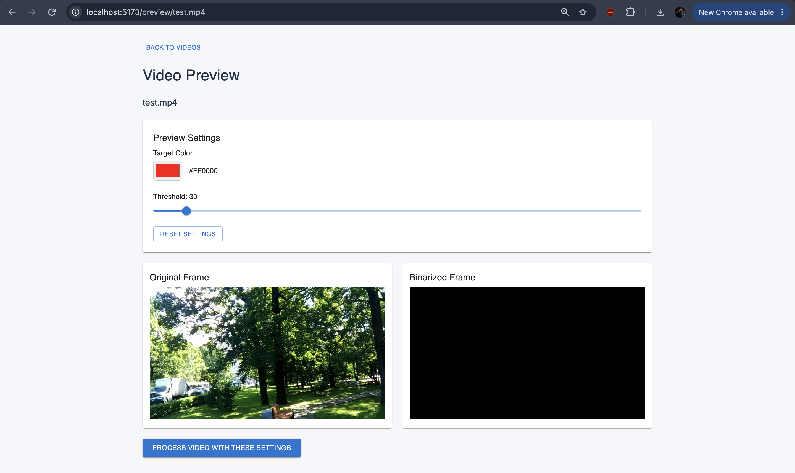
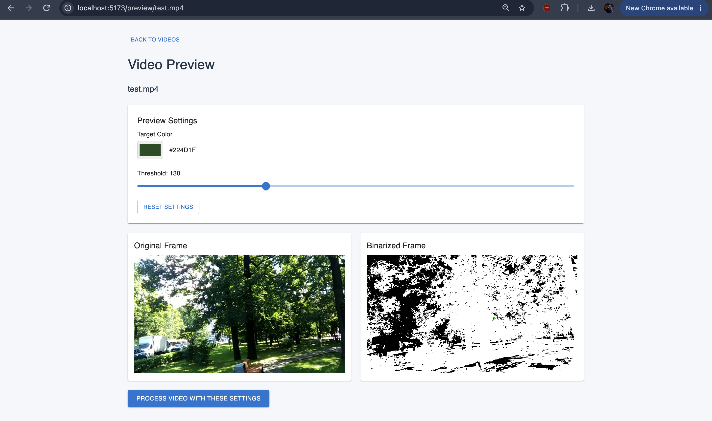
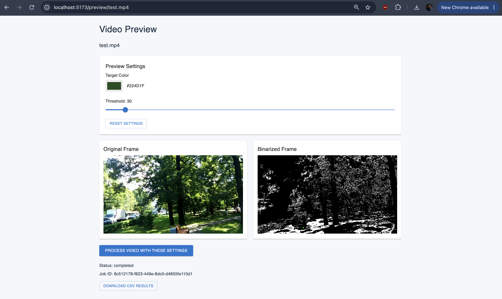

# Centroid Finder Frontend

A React web application for finding and visualizing the centroid of the largest connected group of pixels in a video frame based on a selected target color and threshold.

This project uses React, Vite, Material UI, and Cypress. It connects to a Node.js/Express backend that processes videos using Java.

## Features

- Display available videos from the backend.
- Select a video and view its thumbnail.
- Choose a target color using a color picker.
- Adjust the color-distance threshold using a slider.
- Generate a live black-and-white binarized preview.
- Detect and display the centroid of the largest connected pixel group.
- Reset the color and threshold to default values.
- Submit video-processing jobs to the backend.
- Monitor processing status.
- Download CSV processing results.
- Navigate between pages using React Router.
- Use Material UI components and a higher-order component for layout.

## Technologies Used

- React
- JavaScript
- Vite
- React Router
- Material UI
- Node.js and Express (backend)
- Java (video processing)
- Cypress (automated testing)

## Setup Instructions

### 1. Clone the Repository

```bash
git clone https://github.com/Gurpinder1340/centroid-finder-frontend.git
cd centroid-finder-frontend
```

To use the completed frontend branch:

```bash
git switch frontend-complete
```

### 2. Install Dependencies

```bash
npm install
```

### 3. Start the Backend

The application requires the separate Salamander API backend.

Start the backend from its project directory:

```bash
npm install
npm start
```

The frontend expects the backend to run at:

`http://localhost:3000`

The backend must have its video files and Java processing dependencies configured.

### 4. Start the Frontend

In the frontend directory:

```bash
npm run dev
```

Open:

`http://localhost:5173`

### 5. Use the Application

1. Select a video from the available video list.
2. View the original thumbnail.
3. Choose a target color.
4. Adjust the threshold.
5. View the live binarized image and centroid.
6. Click **Process Video with These Settings**.
7. Wait for the processing status to show completed.
8. Click **Download CSV Results**.

## Testing

Run ESLint:

```bash
npm run lint
```

Build the production application:

```bash
npm run build
```

Run Cypress tests while the frontend development server is running:

```bash
npx cypress run --browser electron
```

### Latest Test Results

- ESLint: Passed
- Production build: Passed
- Cypress: 4 tests passed, 0 failed

## Screenshots

### 1. Video Selection Page



### 2. Video Preview and Settings



### 3. Live Binarization and Centroid Detection



### 4. Processing Results



## Project Structure

```text
src/
├── components/
│   ├── BinarizedPreview.jsx
│   └── withPageLayout.jsx
├── pages/
│   ├── PreviewPage.jsx
│   └── VideosPage.jsx
├── services/
│   └── api.js
├── utils/
│   └── imageProcessing.js
├── App.jsx
├── App.css
├── index.css
└── main.jsx

cypress/
└── e2e/
    └── centroid.cy.js
```

## Backend API Endpoints

| Method | Endpoint | Purpose |
|---|---|---|
| GET | `/api/videos` | List available videos |
| GET | `/thumbnail/:filename` | Retrieve a video thumbnail |
| POST | `/process/:filename` | Start a processing job |
| GET | `/process/:jobId/status` | Check processing status |
| GET | `/results/...` | Retrieve generated results |

## GitHub Repository

https://github.com/Gurpinder1340/centroid-finder-frontend

## Project Status

The frontend implementation includes video selection, live image processing, centroid visualization, backend integration, CSV downloads, and automated UI tests.


## Screenshots

### 1. Video Selection Page

This page displays available videos from the backend.


### 2. Video Preview Page

This page displays the original video frame and processing settings.


### 3. Live Binarization and Centroid Detection

The application updates the binarized image and centroid when the user changes the target color or threshold.


### 4. Video Processing Results

After processing is complete, users can download the generated CSV file.


